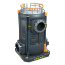

# Advanced Fluid Buffer

A Satisfactory mod that adds a fluid tank with three ports, each behaving differently.

## Ports

| Port | Behaviour |
| --- | --- |
| Free flow | Two-way. Works like the vanilla Fluid Buffer. |
| Controlled outlet | Releases fluid only while the tank is above 75% full. |
| Controlled inlet | Accepts fluid only while the tank is below 75% full. |

The tank holds 400 m3, the same as the vanilla Fluid Buffer, and uses the vanilla buffer UI. It has a climbable ladder.

## Recipe and unlock

- 5 Encased Industrial Beam
- 25 Plastic
- 10 Copper Sheet
- 5 Circuit Board

It unlocks together with the Industrial Fluid Buffer.

## Status

Experimental (0.1.0). Not yet fully tested in game: port push/pull behaviour, ladder, LODs and paint swatches are unverified, and multiplayer and dedicated servers are untested.

## Requirements

- Satisfactory 1.2 (build 491125 or newer)
- [Satisfactory Mod Loader](https://ficsit.app/mod/SML) 3.12.0 or newer

## Building

The repo is a plugin. Place it (or junction it) at `Mods/GameFeatures/AdvancedFluidBuffer` in the SML starter project, then package it with Alpakit.

Assets (buildable, recipe, schematic, icons, ladder, LODs, swatches) are generated by scripts and can be rebuilt:

1. `Art/render_icon.py` (Blender) renders the icons and mod logo.
2. `Scripts/regenerate_assets.ps1` runs `create_assets.py`, then `apply_lods_and_swatches.py`. Order matters.
3. `Scripts/ladder.py` builds the climbable ladder. It reads its dimensions from `Art/build_mesh.py`.

## Author

leanwrldd
